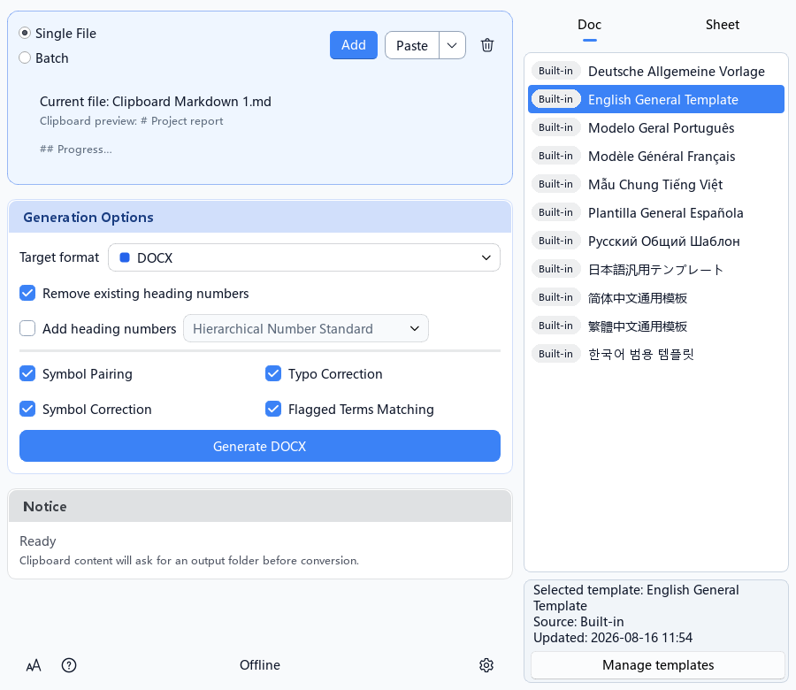
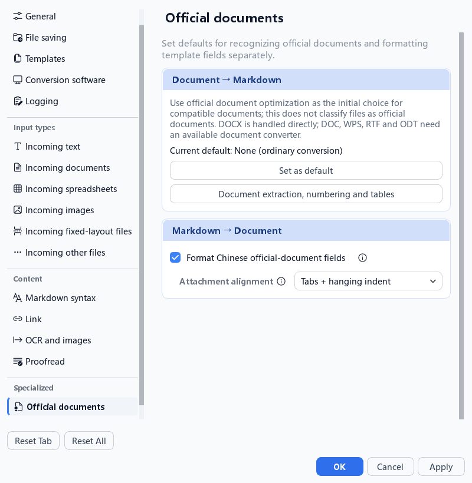

# DocWen

<p align="center">
  
</p>

[English](https://github.com/ZHYX91/docwen/blob/main/README.md) · [简体中文](https://github.com/ZHYX91/docwen/blob/main/docs/user-guides/README.zh-CN.md) · [繁體中文](https://github.com/ZHYX91/docwen/blob/main/docs/user-guides/README.zh-TW.md) · [Deutsch](https://github.com/ZHYX91/docwen/blob/main/docs/user-guides/README.de-DE.md) · [Français](https://github.com/ZHYX91/docwen/blob/main/docs/user-guides/README.fr-FR.md) · [Español](https://github.com/ZHYX91/docwen/blob/main/docs/user-guides/README.es-ES.md) · [Português](https://github.com/ZHYX91/docwen/blob/main/docs/user-guides/README.pt-BR.md) · [Русский](https://github.com/ZHYX91/docwen/blob/main/docs/user-guides/README.ru-RU.md) · [日本語](https://github.com/ZHYX91/docwen/blob/main/docs/user-guides/README.ja-JP.md) · [한국어](https://github.com/ZHYX91/docwen/blob/main/docs/user-guides/README.ko-KR.md) · [Tiếng Việt](https://github.com/ZHYX91/docwen/blob/main/docs/user-guides/README.vi-VN.md) · [العربية](https://github.com/ZHYX91/docwen/blob/main/docs/user-guides/README.ar.md)

DocWen é uma ferramenta local de conversão de documentos e tabelas para Word, Markdown, Excel e outros formatos de escritório. Foi projetada para fluxos offline confiáveis e mantém o processamento dos documentos no computador do usuário.

O idioma da interface controla os textos e o layout do aplicativo. O idioma de saída da tarefa, nos ajustes gerais, controla separadamente rótulos gerados, estilos e comentários de revisão, sem traduzir o conteúdo. Alterar a interface preserva o idioma de saída e o modelo salvos. OCR Automático segue o idioma de saída. A opção de criar um parágrafo do Word por linha de texto Markdown fica desativada por padrão.

## Para que usar o DocWen

Converta Word e Markdown localmente, prepare planilhas e PDFs ou revise textos segundo suas regras. Use a GUI para tarefas comuns e a CLI para repeti-las. Os caminhos dependem do formato e dos programas instalados; veja a [lista de capacidades](../capabilities.md).
## ✨ Funcionalidades Principais

- **📄 Conversão de Formato de Documento** - Conversão bidirecional Word ↔ Markdown. Suporta conversão de fórmulas matemáticas, conversão bidirecional de separadores (três tipos de separadores do Markdown vs. quebras de página, quebras de seção e linhas horizontais do Word) e a restauração de marcadores explícitos `<` / `^` de tabelas Markdown para mesclagens retangulares de tabelas do Word. Suporta formatos como DOCX/DOC/WPS/RTF/ODT.
- **📊 Conversão de planilhas** – Excel ↔ Markdown para XLSX/XLS/ET/ODS/CSV/TSV. Ao exportar células mescladas, escolha repetir o conteúdo, deixar espaços vazios ou preservar as mesclas com marcadores. Modelos XLSX aceitam campos YAML, linhas e colunas de tabelas, imagens e células mescladas. Também é possível combinar várias tabelas.
- **📑 PDF e Arquivos de Layout** - Conversão de PDF/XPS/OFD para Markdown ou DOCX. Suporta fusão, divisão e outras operações de PDF.
- **🖼️ Processamento de Imagem** - Suporta conversão bidirecional e compressão de formatos JPEG/PNG/GIF/BMP/TIFF/WebP/HEIC.
- **📥 Importação de Outros Formatos** - Suporta conversão unidirecional de HTML/MHTML/ENEX/EPUB/PPTX/PPT para Markdown.
- **🔍 Reconhecimento de Texto OCR** - RapidOCR integrado para extrair texto de imagens e PDFs.
- **✏️ Revisão de Texto** - Verifica erros de digitação, pontuação, símbolos e palavras sensíveis em arquivos Word (.docx) e Markdown (.md) com base em dicionários personalizados. As regras podem ser editadas na interface de configurações.
- **📝 Sistema de Modelos** - Mecanismo de modelo flexível que suporta formatos personalizados de documentos e relatórios.
- **💻 Operação em Modo Duplo** - Interface Gráfica do Usuário (GUI) + Interface de Linha de Comando (CLI).
- **🔒 Processamento local com proteção de saída de dependências** - A conversão não depende de serviços online. Enquanto o DocWen é executado, o processo Python bloqueia DNS e IPv4/IPv6 para dependências internas; aplicativos Office externos mantêm a política de rede do sistema.
- **🔗 Operação de Instância Única** - Gerencia automaticamente instâncias do programa e suporta integração com o plugin Obsidian acompanhante.

## 📸 Capturas de tela

Selecione um modelo e as opções de geração de documentos Markdown.



Alinhamento das informações de anexos em documentos oficiais (tela em inglês):




Registro de alterações: veja [CHANGELOG.md](../CHANGELOG.md)

## 🚀 Início Rápido

### Baixar e executar

Baixe o arquivo correspondente em [Releases](https://github.com/ZHYX91/docwen/releases). Os pacotes atendem a **Windows x64**, **Ubuntu 24.04 x64** e **Apple Silicon com macOS 14+**, sem instalar Python. Extraia o arquivo completo: abra `DocWen.exe` no Windows, execute `./DocWen` no Ubuntu; no macOS, mova `DocWen.app` para Aplicativos e siga o [guia do primeiro início](macos.md). Ubuntu e macOS também têm pacotes somente CLI. Outras distribuições Linux e Macs Intel não são destinos dos pacotes.

Os arquivos disponíveis variam conforme a versão. Escolha um arquivo realmente listado para seu sistema; versões antigas podem não incluir pacotes para macOS.

### Executar a partir do código-fonte

Para desenvolver ou instalar pelo código-fonte, instale **Python 3.12** e **uv 0.12.0** e execute no repositório:

```bash
git clone https://github.com/ZHYX91/docwen.git
cd docwen
uv sync --frozen --all-extras
uv run --frozen docwen-gui
uv run --frozen docwen --help
```

`uv run --frozen` usa o ambiente sincronizado sem ativação manual. A CI e as compilações de produção usam uv 0.12.0; a manutenção de dependências aceita versões 0.12.x compatíveis. `pip install -e` não é suportado porque o pip não aplica a exclusão específica de dependências deste repositório.

### Observações para macOS

Os pacotes Mac mantêm assinatura ad-hoc, sem Developer ID ou notarização Apple. Consulte [instalação e primeira abertura](macos.md).

**Suporte ao LibreOffice (Opcional)**

Para converter formatos legados como `.doc` e `.xls`, instale o LibreOffice:  
Download: https://www.libreoffice.org/download/

**Imagens HEIC/HEIF**

Os pacotes usam o próprio backend de imagens. Verifique a versão instalada com `DocWenCLI doctor --json` (o caminho da CLI no macOS está no guia abaixo). Instalar `pillow-heif` no Python do sistema não altera o aplicativo. No código-fonte, `uv sync --frozen --all-extras` já instala `pillow-heif`. Se o backend do macOS informar que falta uma biblioteca nativa, execute `brew install libheif` e confira com `uv run --frozen docwen doctor --json`. A disponibilidade depende da compilação e do backend usados.

### Pré-requisitos do GUI no Linux

**Destino de pacote compatível**: O DocWen oferece suporte à GUI e à CLI do pacote Ubuntu
24.04 x64. Estes pré-requisitos não ampliam esse compromisso para outra distribuição ou arquitetura.

- Ambiente de desktop instalado (GNOME, KDE, XFCE, etc.)
- A GUI usa PySide6 (Qt6). Se a inicialização falhar por falta de bibliotecas do sistema, instale as bibliotecas necessárias para executar o Qt indicadas pelo erro (geralmente relacionadas a OpenGL/X11).
- Sem ambiente de desktop, execute `./DocWenCLI` na pasta do pacote CLI extraído, ou `uv run --frozen docwen` na pasta do código-fonte.

### Guia de Início Rápido

1.  **Prepare um Arquivo Markdown**:

    ```markdown
    ---
    Título: Documento de Teste
    ---
    
    ## Título de Teste
    
    Este é o conteúdo do corpo de teste.
    ```

2.  **Conversão Arrastar e Soltar**:
    - Inicie o programa.
    - Arraste o arquivo `.md` para a janela.
    - Selecione um modelo.
    - Clique em "Gerar DOCX".

3.  **Obter Resultados**:
    - O documento Word é salvo em uma pasta de resultados no local de saída configurado. Abra esse local pela barra de status.

**Dica**: Você pode usar os arquivos de exemplo no diretório `samples/` para experimentar rapidamente as funcionalidades do software.

## 🖥️ Uso da Interface Gráfica

Ao iniciar uma tarefa, suas opções reais são exibidas. Pesquise modelos pelo nome ou pela dica de uso; “Usados nesta sessão” lista os modelos de tarefas iniciadas sem alterar o padrão. Para tabelas, veja [escopo, modos e conferência dos resultados](table-merge.md).

### Visão Geral da Interface

O programa usa um **layout adaptável de três colunas**:

| Área | Descrição | Tempo de Exibição |
| :--- | :--- | :--- |
| **Coluna Central (Área Principal)** | Área de arrastar e soltar arquivos, painel de operação, barra de status | Sempre exibido |
| **Coluna Direita** | Seletor de modelo / Painel de conversão de formato | Expande automaticamente após selecionar um arquivo |
| **Coluna Esquerda** | Lista de arquivos em lote (agrupados por tipo) | Exibido ao mudar para modo de lote |

### Fluxo de Operação Básico

1.  **Iniciar Programa**: Clique duas vezes em `DocWen.exe` (Windows empacotado) ou execute `uv run --frozen docwen-gui`.
2.  **Importar Arquivo**:
    -   Método 1: Arraste e solte arquivos diretamente na janela.
    -   Método 2: Clique no botão "Adicionar" na área de arrastar e soltar para selecionar arquivos.
3.  **Selecionar Modelo** (se a conversão for necessária): O painel de modelo direito expande automaticamente; selecione um modelo adequado.
4.  **Configurar Opções**: Marque as opções de conversão/exportação necessárias no painel de operação.
5.  **Executar Operação**: Clique no botão de função correspondente (por exemplo, "Exportar MD", "Gerar DOCX", etc.).
6.  **Ver resultado**: A barra de status mostra o progresso e o resultado; clique na ação "Abrir saída" à direita para abrir o local de saída.

### Modo de Arquivo Único vs. Modo de Lote

O programa suporta dois modos de processamento, alternáveis via botão de alternância na área de arrastar e soltar arquivos:

**Modo de Arquivo Único** (Padrão):
-   Processa um arquivo de cada vez.
-   Interface simples, adequada para uso diário.

**Modo de Lote**:
-   Importa vários arquivos simultaneamente.
-   Coluna esquerda mostra lista de arquivos categorizada (agrupados por documento/planilha/imagem, etc.).
-   Suporta adição, remoção e classificação em lote.
-   Clicar em um arquivo na lista muda o alvo da operação atual.

### Funções do Painel de Operação

O painel de operação ajusta automaticamente as opções disponíveis com base no tipo de arquivo:

| Tipo de Arquivo | Operações Disponíveis |
| :--- | :--- |
| Documento Word | Exportar MD, Converter PDF, Revisão de Texto, OCR |
| Markdown | Converter DOCX, Converter PDF, Revisão de Texto |
| Planilha Excel | Exportar MD, Converter PDF, Resumo de Tabela |
| Arquivo PDF | Exportar MD, Mesclar, Dividir, OCR |
| Arquivo de Imagem | Conversão de Formato, Compressão, OCR |
| HTML/EPUB/PPTX etc. | Exportar MD |

### Interface de Configurações

Abra as configurações pelo ícone na parte inferior da janela ou com **Ctrl+,**. A navegação lateral é agrupada em **Geral**, **Tipos de entrada**, **Conteúdo** e **Especializados**. Ela rola em janelas baixas e só vira um seletor suspenso quando não há largura suficiente.

**OCR e imagens** reúne opções comuns de reconhecimento e saída de imagens no Markdown. O OCR padrão de cada arquivo permanece na respectiva página de entrada; conversão e compactação de imagens ficam em **Imagens de entrada**. **Sintaxe Markdown** separa convenções de saída, regras de leitura e mapeamentos do Word. Nem todas as origens e otimizações seguem todas as opções de sintaxe.

**Documentos oficiais** e **Faturas** têm páginas próprias. Para documentos oficiais, **Documento → Markdown** define a escolha inicial de reconhecimento e **Markdown → Documento** a formatação de campos do modelo, com ajuda sobre anexos, destinatários em cópia, datas e notas. Faturas têm padrões separados para **PDF / OFD → Markdown** e **Imagem → Markdown**. Eles apenas definem a escolha inicial de arquivos compatíveis, sem identificá-los automaticamente. **Aplicar / OK** salva; **Cancelar** descarta alterações não aplicadas.

**Escopo:** A formatação especializada de campos é voltada a documentos oficiais chineses, e a otimização da extração de faturas é voltada a formatos de faturas chinesas. Outros arquivos continuam podendo usar as conversões normais.

### Atalhos

-   **Arrastar Arquivo Externo**: Arraste diretamente para a janela para importar.
-   **Abrir saída**: Clique na ação "Abrir saída" no lado direito da barra de status para abrir o local de saída.
-   **Clique com o botão direito no Item de Modelo**: Abre a localização do arquivo de modelo.

---

## 🔧 Uso da CLI

Os exemplos de CLI usam o nome `docwen`. No diretório do código-fonte, acrescente `uv run --frozen` antes do comando; em um pacote, use `DocWenCLI.exe` (Windows) ou `./DocWenCLI` (Linux/macOS).

A linha de comando (CLI) permite verificar e converter arquivos pelo terminal ou automatizar tarefas locais com scripts. Para integrar o DocWen a outros aplicativos, use a interface Machine Protocol descrita abaixo.

### Fluxo recomendado para automação

Em scripts de automação local, você pode verificar e executar a conversão nesta ordem:

1. `inspect <file> [--json]`: detectar primeiro a categoria real do arquivo, o formato e as ações suportadas.
2. `resources list formats --json`: ler as rotas realmente disponíveis no DocWen e seus requisitos de dependência.
3. `schema convert`: ler o contrato legível por máquina e as regras condicionais de `convert`.
4. `convert <file> --to <fmt> (--output-dir <dir> | --output <path>) --dry-run --json`: pré-visualizar detecção, normalização e roteamento sem gravar arquivos.
5. `convert <file> --to <fmt> (--output-dir <dir> | --output <path>) ...`: executar a conversão real somente depois.

Aplicativos e plugins se conectam por `serve --stdio` com Machine Protocol v2 para consultar operações, planejar tarefas e executá-las. Essa é a interface estável para integrações; CLI `--json` é voltado a scripts de terminal. Use `gui open|activate|status` para abrir arquivos no aplicativo de desktop ou trazer sua janela para a frente.

### Exemplos comuns

Conversões de ou para Markdown criam uma pasta de resultados em `--output-dir DIR`, mesmo com um único arquivo. Os nomes incluem o nome original, data e hora e o formato de entrada atual. Use `--output PATH` apenas para outras conversões com um arquivo de destino exato.

```bash
# Pacote do Windows
DocWenCLI.exe inspect document.docx --json

# Exportar o contrato de convert para scripts / agentes
DocWenCLI.exe schema convert

# Pré-visualizar a execução sem gravar resultados
DocWenCLI.exe convert report.docx --to md --output-dir exports --extract-img --ocr --dry-run --json

# Exportar Word para Markdown (extração de imagens + OCR)
DocWenCLI.exe convert report.docx --to md --output-dir exports --extract-img --ocr

# Markdown para Word (modelo + modo de mesclagem título/corpo)
DocWenCLI.exe convert document.md --to docx --output-dir exports --template template.docx.bc1e1d050b189f112cd8137fe505d8fa3259d2552b382f4d0025ac279660ddcf --heading-merge-mode punct_required

# Markdown para Word e revisão do DOCX gerado antes da publicação
DocWenCLI.exe convert document.md --to docx --output-dir exports --proofread --check typo --check punct

# Controlar modo de imagem e posição do texto OCR no Markdown
DocWenCLI.exe convert report.docx --to md --output-dir exports --extract-img --image-mode file --ocr --ocr-placement image_md

# Consultar capacidades em tempo de execução e portas de dependência
DocWenCLI.exe doctor --json
DocWenCLI.exe resources list formats --json

# Revisão de documentos
DocWenCLI.exe validate document.docx --check typo --check punct
DocWenCLI.exe validate input.md --check typo --check punct

# A partir do código-fonte / uv
# inspect -> schema -> dry-run -> convert
# docwen inspect document.docx --json
# docwen schema convert
# docwen convert document.docx --to md --output-dir exports --dry-run --json
# docwen convert document.docx --to md --output-dir exports
```

### Principais comandos e opções

| Comando / opção | Descrição |
| --- | --- |
| `convert <file> --to <fmt> (--output-dir <dir> \| --output <path>)` | Ponto de entrada unificado para conversões. |
| `convert <markdown> --to docx --output-dir <dir> --proofread [--check ...]` | Revisa o DOCX gerado após Markdown→DOCX; `--check` em `convert` exige `--proofread`. Sem `--check`, são usados os padrões de revisão configurados. |
| `convert <file> --to <fmt> (--output-dir <dir> \| --output <path>) --dry-run --json` | Pré-visualiza detecção, normalização, roteamento e opções efetivas sem executar a conversão real. |
| `schema convert` | Exporta o contrato legível por máquina, valores padrão, condições e chaves canônicas de `convert`. |
| `validate <file> --check ...` | Revisão de documentos (`typo/punct/symbol/sensitive/all/none`). Use `--json` para o envelope da CLI; `--report` é um caminho opcional para o arquivo de relatório. |
| `inspect <file> [--json]` | Inspeciona categoria/formato do arquivo, ações recomendadas e avisos de divergência entre extensão e conteúdo. |
| `doctor --json` | Retorna diagnósticos junto com resumos de capacidades em tempo de execução e portas de dependência. |
| `resources list formats --json` | Lista formatos de destino por categoria de origem com resumos de dependências em tempo de execução e limitações. |
| `resources list optimizations --json` | Listar recursos de otimização tipados e seus vínculos de rota canônicos. |
| `resources list templates` | Lista os modelos disponíveis. |
| `resources list numbering-schemes` | Lista os esquemas de numeração disponíveis. |
| `gui open [ABSOLUTE_FILE] [--timeout <seconds>] [--json]` | Iniciar ou ativar o DocWen pelo controle GUI local separado e, opcionalmente, abrir um arquivo absoluto. |
| `--template <id>` | ID canônico exato retornado por `resources list templates`; nomes exibidos, nomes de arquivos e caminhos são rejeitados. IDs DOCX valem para `docx/doc/odt/rtf/wps/pdf`, IDs XLSX para `xlsx/xls/ods/csv`. |
| `--extract-img` / `--no-extract-img` / `--ocr` | Extração de imagens e OCR para `convert --to md`. |
| `--image-mode file\|base64\|embed\|omit` | Controla como as imagens são emitidas durante a exportação para Markdown. |
| `--ocr-placement image_md\|main_md` | Controla se o texto OCR é gravado no Markdown auxiliar da imagem ou no Markdown principal. |
| `--heading-merge-mode punct_required\|always\|never` | Controla a estratégia de mesclagem entre título + corpo para `convert --to docx`. |
| `--optimization <id>` | Ativa explicitamente um perfil de otimização (veja `resources list optimizations`). |
| `batch convert\|validate ... --jobs <n> [--continue-on-error]` | Controles de processamento em lote. |
| `--json` / `--quiet` / `--timing` | Exibir JSON, reduzir logs ou incluir o tempo decorrido em scripts de terminal. |

No modo `punct_required`, a lista padrão exata é `。：！？.:!?`. Ela pode ser editada nas configurações de formatação; um valor vazio desativa a mesclagem nesse modo. Vírgulas, ponto e vírgula, vírgulas de enumeração, travessões e reticências ficam fora do padrão.


Mais exemplos da CLI: confira os IDs públicos de otimização antes de usar; o relatório de revisão só é gravado com `--report`.

```bash
DocWenCLI.exe resources list optimizations --json
DocWenCLI.exe convert report.docx --to md --output-dir exports --optimization gongwen
DocWenCLI.exe validate input.md --check typo --report report.json
```

## 📝 Convenções de Sintaxe Markdown

**Usa extensões Markdown do Obsidian?** Quatro extensões opcionais vêm **desativadas em novas instalações** do DocWen: `structural_tables` (células mescladas e cabeçalhos em várias linhas), `captions_references` (legendas e referências do Number Suite), `extended_headings` (H7–H9) e `typed_endnotes` (notas finais tipadas).

- **Markdown → Word:** em **Configurações → Sintaxe Markdown → Entrada**, ative as extensões necessárias ou o perfil **Extensões do Obsidian** para entrada. Sem isso, alguns marcadores permanecem como texto literal.
- **Word → Markdown:** ative separadamente as **extensões de saída** correspondentes (ou o perfil de saída). Caso contrário, estruturas podem ser simplificadas ou normalizadas com avisos.

Guarde o Markdown original e confira o DOCX. A numeração do Word segue as opções de conversão do DocWen; não há garantia de recuperar exatamente a mesma sintaxe ou os espaços originais. Consulte a [referência de compatibilidade](../specs/markdown-compatibility.md).

### Mapeamento de Nível de Cabeçalho

Para facilitar a memorização por colegas sem conhecimento prévio, os cabeçalhos Markdown neste software correspondem **um-para-um** com os cabeçalhos do Word:
- O título e subtítulo do documento são colocados nos metadados YAML.
- Markdown `# Cabeçalho 1` corresponde ao Word "Cabeçalho 1".
- Markdown `## Cabeçalho 2` corresponde ao Word "Cabeçalho 2".
- E assim por diante, suportando até 9 níveis de cabeçalhos.

**Dica**: Se você prefere usar o cabeçalho de primeiro nível do Markdown (`#`) como o título do documento, começando com cabeçalhos de segundo nível (`##`) para os subtítulos do corpo, você pode estilizar "Título 1" no modelo Word para parecer com um título de documento (por exemplo, centralizado, negrito, tamanho de fonte maior), e selecionar um esquema de numeração que ignore a numeração de cabeçalhos de primeiro nível nas configurações. Desta forma, seus cabeçalhos de primeiro nível aparecerão como títulos de documento.

### Quebras de Linha e Parágrafos

**Regra básica**: Quebras suaves de linha em Markdown **não** criam parágrafos separados no Word por padrão. Ative **Cada linha como parágrafo** em **Configurações → Sintaxe Markdown** para separar linhas de texto. Listas, citações, código e quebras explícitas mantêm suas regras.

**Parágrafos Mistos**: Quando um subtítulo precisa ser misturado com o corpo do texto no mesmo parágrafo (modo padrão: "Pontuação obrigatória"), as seguintes condições devem ser atendidas:
1.  O subtítulo termina com um sinal de pontuação de fim (suporta pontuação multilíngue, incluindo pontos, pontos de interrogação, pontos de exclamação e outros sinais de pontuação de fim comuns).
2.  O corpo do texto está localizado na **linha imediatamente seguinte** do subtítulo.
3.  A linha do corpo do texto não pode ser um elemento Markdown especial (como cabeçalhos, blocos de código, tabelas, listas, citações, blocos de fórmula, separadores, etc.).

**Exemplo**:
```markdown
## I. Requisitos de Trabalho.
Esta reunião exige que todas as unidades implementem seriamente...
```
As duas linhas acima serão mescladas no mesmo parágrafo, onde "I. Requisitos de Trabalho." mantém o formato de subtítulo, e "Esta reunião..." mantém o formato de corpo de texto.

**Nota**:
- Não pode haver uma linha vazia entre o subtítulo e o corpo do texto; caso contrário, serão reconhecidos como parágrafos separados.
- Por padrão (modo "Pontuação obrigatória"), se o subtítulo não terminar com um sinal de pontuação de fim, ele não será mesclado com a próxima linha mesmo sem linha em branco.
- Altere o modo e os caracteres que iniciam a junção em **Configurações → Texto de entrada → Markdown para Documento — Processamento de formato → Modo de fusão entre título e corpo**.

### Conversão Bidirecional de Separadores

Suporta conversão bidirecional entre separadores Markdown e quebras de página/quebras de seção/linhas horizontais do Word:

-   **DOCX → MD**: Quebras de página, quebras de seção e linhas horizontais do Word são automaticamente convertidas para separadores Markdown.
-   **MD → DOCX**: Markdown `---`, `***`, `___` são automaticamente convertidos para elementos correspondentes do Word.
-   **Configurável**: Relações de mapeamento específicas podem ser personalizadas na interface de configurações.

### Listas de Tarefas

Suporta a conversão bidirecional de listas de tarefas GFM:

```markdown
- [ ] Pendente
- [x] Concluído
```

-   **MD → DOCX**: Renderizado como lista com marcadores com prefixo de texto `☐` / `☑`.
-   **DOCX → MD**: Converte itens de lista que começam com `☐` / `☑` / `☒` para `- [ ]` / `- [x]`.
-   **Nota sobre fontes**: `☐`/`☑` podem não ser exibidos em algumas fontes. Se necessário, use fontes como "Segoe UI Symbol" no seu modelo do Word.

### Inserção de Imagens e Tamanho

Suporta imagens incorporadas estilo Obsidian/Wiki e Markdown padrão, com tamanho opcional (px):

```markdown
![[image.png]]
![[image.png|300]]
![[image.png\|300]]


```

- Sem tamanho: tamanho original, limitado pela largura disponível (página/célula)
- Com tamanho: permite ampliar, ainda limitado pela largura disponível
- Parágrafo só com imagem: usa o estilo de parágrafo “Image” (centralizado, espaçamento simples)

### Tratamento de Links

Suporta links clicáveis em Markdown -> DOCX:

```markdown
[Docwen](https://example.com)
[[Target]]
[[Target|Open target]]
<https://example.com>
<user@example.com>
```

- Links Markdown e Wiki são convertidos por padrão em hiperlinks do Word
- Links Wiki são resolvidos para links locais `file:///` quando o arquivo de destino é encontrado
- Autolinks entre `< >` suportam `https://...` e e-mails `mailto:...`
- A vinculação automática de URLs simples é avaliada por solicitação para Markdown -> DOCX, fica desativada por padrão e é ativada por `[non_embed_links].auto_link_bare_url` em `configs/link.toml`
- Markdown -> XLSX não gera placeholders de hiperlink do DOCX e preserva a sintaxe original do link

## 📖 Guia de Uso Detalhado

### Word para Markdown

1.  Arraste o arquivo `.docx` para a janela do programa.
2. Escolha as opções de exportação e clique em **Exportar Markdown**.
3.  Gera um arquivo `.md` contendo metadados YAML.

**Formatos Suportados**:
-   `.docx` - Documento Word Padrão.
-   `.doc` - Convertido automaticamente para DOCX para processamento.
-   `.wps` - Documento WPS convertido automaticamente.

**Opções de Exportação**:

| Opção | Descrição |
| :--- | :--- |
| **Extrair Imagens** | Se marcado, as imagens no documento são extraídas para a pasta de saída, e links de imagem são inseridos no arquivo MD. |
| **OCR** | Reconhece texto nas imagens. Conforme a configuração de saída do OCR, salva em um arquivo Markdown por imagem ou no arquivo Markdown principal. |
| **Otimização** | Aplica uma otimização para o tipo de documento escolhido, como extrair campos de documentos oficiais chineses. Se desativada, usa a conversão padrão. |
| **Remover num.** | Se marcado, remove números antes dos subtítulos (por exemplo, "一、", "（一）", "1.", etc.) e os converte em texto de título puro. |
| **Add num.** | Se marcado, adiciona automaticamente números com base nos níveis de cabeçalho (esquema de numeração pode ser configurado nas configurações). |

Os números de títulos de listas multinível do Word/WPS são preservados na exportação. Ative **Remover num.** para remover os números sem alterar os níveis dos títulos.

### Markdown para Word

1.  Prepare um arquivo `.md` com um cabeçalho YAML.
2.  Arraste-o para a janela do programa e selecione o modelo Word correspondente.
3. Selecione DOCX como formato de destino e clique em **Gerar DOCX** para preencher o modelo e salvar o documento.

**Opções de Conversão**:

| Opção | Descrição |
| :--- | :--- |
| **Remover num.** | Se marcado, remove números antes dos subtítulos. |
| **Add num.** | Se marcado, adiciona automaticamente números com base nos níveis de cabeçalho. |

**Nota**: Se houver parágrafos onde subtítulos e corpo de texto são misturados no documento, quebras de linha estritas devem ser mantidas no arquivo MD (veja "Quebras de Linha e Parágrafos" acima).

### Processamento Automático de Estilo de Modelo

O conversor detecta e processa automaticamente estilos de modelo durante a conversão Markdown → DOCX:

#### Classificação de Estilo

**Estilo de Parágrafo**: Aplicado a todo o parágrafo.

| Estilo | Comportamento de Detecção | Injeção quando Ausente | Fonte |
| :--- | :--- | :--- | :--- |
| Cabeçalho (1~9) | Detecta estilo de parágrafo | Estilos de cabeçalho de modelo | Word Embutido |
| Bloco de Código | Detecta estilo de parágrafo | Fonte Consolas + Fundo cinza | Definido pelo Software |
| Citação (1~9) | Detecta estilo de parágrafo | Fundo cinza + Borda esquerda | Definido pelo Software |
| Bloco de Fórmula | Detecta estilo de parágrafo | Estilo específico de fórmula | Definido pelo Software |
| Separador (1~3) | Detecta estilo de parágrafo | Estilo de parágrafo de borda inferior | Definido pelo Software |

**Estilo de Caractere**: Aplicado ao texto selecionado.

| Estilo | Comportamento de Detecção | Injeção quando Ausente | Fonte |
| :--- | :--- | :--- | :--- |
| Código em Linha | Detecta estilo de caractere | Fonte Consolas + Sombreamento cinza | Definido pelo Software |
| Fórmula em Linha | Detecta estilo de caractere | Estilo específico de fórmula | Definido pelo Software |

**Estilo de Tabela**: Aplicado a toda a tabela.

| Estilo | Comportamento de Detecção | Injeção quando Ausente | Fonte |
| :--- | :--- | :--- | :--- |
| Tabela de Três Linhas | Prioridade de configuração do usuário | Definição de estilo de tabela de três linhas | Definido pelo Software |
| Tabela de Grade | Prioridade de configuração do usuário | Definição de estilo de tabela de grade | Definido pelo Software |

**Definição de Numeração**: Usado para formatos de lista.

| Tipo | Comportamento de Detecção | Manuseio quando Ausente |
| :--- | :--- | :--- |
| Numeração de Lista | Verifica definições de lista ordenada/não ordenada existentes no modelo | Usa predefinição decimal/marcador |

#### Internacionalização de Nome de Estilo

-   **Estilos Embutidos do Word** (cabeçalho 1~9):
    -   Nomes de estilo usam nomes ingleses padrão do Word (por exemplo, `heading 1`).
    -   O Word exibe automaticamente nomes localizados com base no idioma do sistema (por exemplo, "Título 1" em sistemas em português).
-   **Estilos Definidos pelo Software** (Bloco de Código, Citação, Fórmula, Separador, Tabela, etc.):
    -   Novos estilos gerenciados seguem o **idioma de saída da tarefa** das configurações gerais, não o idioma da interface. Mudar a interface não renomeia estilos já presentes no modelo.

**Sugestão**: Depois de personalizar estilos no modelo, o conversor usará automaticamente seus estilos; se não estiverem presentes no modelo, usará estilos predefinidos embutidos.

### Processamento de Arquivo de Planilha

1. **Excel/CSV para Markdown**: Adicione um arquivo `.xlsx` ou `.csv` e clique em **Exportar Markdown**.
2.  **Markdown para Excel**: Tabelas Markdown podem ser exportadas para XLSX. Modelos aceitam campos YAML, placeholders de coluna e imagem e células mescladas ou protegidas.

**Formatos Suportados**:
-   `.xlsx` - Documento Excel Padrão.
-   `.xls` - Convertido automaticamente para XLSX para processamento.
-   `.et` - Planilha WPS convertida automaticamente.
-   `.csv` - Tabela de texto CSV.
-   `.tsv` - Tabela TSV separada por tabulação.


### Função de Revisão de Texto

O programa fornece quatro regras de revisão personalizáveis:

1.  **Verificação de Emparelhamento de Pontuação** - Detecta se pontuações emparelhadas como parênteses e aspas correspondem.
2.  **Revisão de Símbolos** - Detecta uso misto de pontuação chinesa e inglesa.
3.  **Verificação de Erros de Digitação** - Verifica erros de digitação comuns com base em um dicionário personalizado.
4.  **Detecção de Palavras Sensíveis** - Detecta palavras sensíveis com base em um dicionário personalizado.

**Dicionários Personalizados**: Edite visualmente dicionários de erros de digitação e palavras sensíveis na interface "Configurações".

**Uso**:
1.  Arraste o documento Word ou arquivo Markdown a ser revisado para o programa.
2.  Marque as regras de revisão necessárias.
3.  Clique no botão "Revisão de Texto".
4.  Os resultados da revisão são exibidos como comentários no documento. Para arquivos Markdown, os resultados são gerados como relatório JSON.

Observação (relatório JSON de revisão para Markdown):
- Motor: `text_rules` + adaptador Markdown `md_spell`
- Saída: o caminho atual de revisão na CLI é `validate`; use `--json` para o envelope da CLI. `--report` é um caminho opcional para o arquivo de relatório.

- Diferente de `--json` (camada JSON da CLI)

## 🛠️ Sistema de Modelos

### Usando Modelos Existentes

Gerencie modelos DOCX/XLSX em **Configurações → Modelos**: ativação, ordem e modelo padrão. Os modelos integrados são somente leitura; os personalizados ficam em uma pasta gravável do usuário. O MSIX não exige alterações em WindowsApps.

### Modelos Personalizados

1. Copie e edite um modelo integrado ou importe um arquivo DOCX/XLSX existente.
2. Ajuste conteúdo, estilos e espaços reservados da cópia no Word, Excel ou WPS; consulte as regras abaixo.
3. Salve o arquivo e atualize a lista no DocWen. Não é necessário reiniciar.

### Uso de Espaço Reservado

#### Espaços Reservados de Modelo Word

**Espaços Reservados de Campo YAML**: Use o formato `{{Nome do Campo}}` no modelo, que será substituído pelo valor correspondente no cabeçalho YAML do arquivo Markdown durante a conversão.

| Espaço Reservado | Descrição |
| :--- | :--- |
| `{{Título}}` | Título do documento (Regras de recuperação veja abaixo) |
| `{{Corpo}}` | Posição de inserção do conteúdo do corpo Markdown |
| Outros | Suporta qualquer campo personalizado |

**Prioridade de Recuperação de Título**:

| Prioridade | Fonte | Descrição |
| :--- | :--- | :--- |
| 1 | Campo YAML `Title` | Maior prioridade |
| 2 | Campo YAML `aliases` | Pega o primeiro elemento da lista, ou valor da string |
| 3 | Nome do arquivo | Nome do arquivo sem extensão `.md` |

**Suporte multilíngue**: Os espaços reservados título e corpo suportam múltiplos idiomas, ex: título pode ser `{{Título}}`, `{{title}}`, `{{标题}}`, etc., corpo pode ser `{{Corpo}}`, `{{body}}`, `{{正文}}`, etc.

#### Espaços Reservados de Modelo Excel

Modelos XLSX aceitam campos YAML, placeholders verticais `{{↓campo}}` e horizontais `{{→campo}}`, placeholders de imagem e células mescladas ou protegidas.

**1. Espaço Reservado de Campo YAML** `{{Nome do Campo}}`

Usado para preencher um único valor do cabeçalho YAML do arquivo Markdown:

```markdown
---
ReportName: Estatísticas de Vendas Anuais 2024
Unit: Depto de Vendas
---
```

`{{ReportName}}`, `{{Unit}}` no modelo serão substituídos pelos valores correspondantes. O campo de título também segue as regras de prioridade.

**2. Espaço Reservado de Preenchimento de Coluna** `{{↓Nome do Campo}}`

Extrai dados da tabela Markdown e preenche **para baixo** linha por linha a partir da posição do espaço reservado:

```markdown
| ProductName | Quantity |
|:--- |:--- |
| Produto A | 100 |
| Produto B | 200 |
```

`{{↓ProductName}}` no modelo Excel será substituído por "Produto A", e a próxima linha será preenchida com "Produto B".

**3. Espaço Reservado de Preenchimento de Linha** `{{→Nome do Campo}}`

Extrai dados da tabela Markdown e preenche **para a direita** coluna por coluna a partir da posição do espaço reservado:

```markdown
| Month |
|:--- |
| Jan |
| Fev |
| Mar |
```

`{{→Month}}` no modelo Excel será preenchido com "Jan", "Fev", "Mar" sequencialmente para a direita.

**Manuseio de Células Mescladas**:

- Markdown -> Excel continua preservando os merged ranges originais do modelo.
- Em regiões conhecidas do modelo orientadas por coluna e compostas por placeholders contíguos `{{↓Nome do Campo}}`, o programa pode restaurar mesclagens retangulares a partir de marcadores explícitos `<` / `^` em tabelas Markdown.
- Apenas células cujo conteúdo, após remover espaços nas extremidades, seja exatamente `<` ou `^` participam da detecção de mesclagem; `\<` e `\^` permanecem como texto literal.
- Retângulos inválidos ou conflitos com merged ranges já existentes no modelo são rebaixados para texto normal com aviso, em vez de sobrescrever à força a estrutura do modelo.

**Mesclagem de Dados Multi-tabela**: Se houver várias tabelas no Markdown usando o mesmo nome de cabeçalho, os dados serão mesclados em ordem e preenchidos sequencialmente.

## 🔌 Plugin Obsidian

Um plugin Obsidian complementar é publicado separadamente e funciona integrado ao conversor:

### Funcionalidades Principais

-   **🚀 Lançamento em Um Clique** - Ícone da barra lateral para iniciar rapidamente o conversor.
-   **📂 Transferência Automática** - Passa automaticamente o caminho do arquivo aberto atualmente.
-   **🔄 Reutilizar a janela aberta** - Abre outro arquivo no conversor sem reiniciá-lo.

### Como usar o plugin

O DocWen Assistant oferece suporte a desktops Windows e Linux. No Windows, instalações da Microsoft Store podem usar detecção automática; no Linux, um pacote compatível extraído é selecionado manualmente. O Assistant atualmente não oferece suporte ao macOS.

1.  **Primeiro clique** → Inicia o conversor e abre o arquivo atual.
2.  **Novo clique com um arquivo aberto** → Substitui o arquivo de entrada atual por esse arquivo (modo de arquivo único).
3.  **Novo clique sem um arquivo aberto** → Traz a janela do conversor para a frente.

### Instalação

Instale o DocWen separadamente e escolha uma [versão publicada do DocWen Assistant](https://github.com/ZHYX91/obsidian-docwen-assistant/releases) compatível. O plugin não instala o programa principal. Consulte as notas de cada versão, não um número fixo neste guia. Integrações usam Machine Protocol v2 e Artifact Bundle v3.

## 🔌 OpenClaw (Plugin + Skill)

[docwen-openclaw](https://github.com/ZHYX91/docwen-openclaw) permite converter e revisar arquivos locais usando o DocWen instalado separadamente. Confira as [versões publicadas do plugin](https://github.com/ZHYX91/docwen-openclaw/releases) e o contrato [Machine Protocol v2 e Artifact Bundle v3](../specs/machine-protocol-v2.md).

## ❓ Perguntas Frequentes

### E se a conversão falhar?

-   Verifique se o arquivo está ocupado por outro programa.
-   Confirme se o formato do arquivo está correto.
-   Verifique nas configurações o campo "Caminho real atual do arquivo de log" ou consulte os logs de erro no diretório de logs do usuário do sistema; se a verificação do pacote usar `DOCWEN_LOG_DIR`, verifique em vez disso o diretório sobrescrito.

### Modelo não aparece?

- Em **Configurações → Modelos**, confirme que o modelo está ativado e corresponde ao formato de saída.
- Confirme que o arquivo DOCX/XLSX abre normalmente.
- Atualize a lista após alterações externas; importe novos arquivos.

### Função de revisão não funciona?

- CLI `validate` verifica diretamente `.md` e `.docx`. Também aceita `.doc`, `.wps`, `.rtf` e `.odt`, após conversão para DOCX por um programa Office local compatível. Em caso de falha, confira essa dependência.
-   Verifique se o documento contém texto editável.
-   Confirme se as regras de revisão estão habilitadas nas configurações.

### Formato de saída não conforme esperado?

- Abra **Configurações → Modelos**. Copie os modelos integrados antes de editar; os personalizados podem ser editados diretamente.
- Ajuste os estilos no Word, Excel ou WPS, salve e atualize a lista.
- Selecione o modelo personalizado antes de gerar novos arquivos.

### Células de fórmula ficam vazias após a conversão de Excel para Markdown?

Este é o comportamento esperado. O programa lê os **valores em cache** das células em vez das próprias fórmulas.

**Razão técnica**:
-   Em arquivos Excel, as células de fórmula armazenam tanto a fórmula quanto o último resultado calculado (valor em cache).
-   O programa usa o modo `data_only=True`, que recupera apenas valores em cache.
-   Se o arquivo nunca foi aberto no Excel (por exemplo, gerado por um programa), ou foi editado mas não salvo novamente, o valor em cache estará vazio.

**Solução**:
1.  Abra o arquivo no Excel.
2.  Aguarde a conclusão do cálculo das fórmulas.
3.  Salve o arquivo.
4.  Converta novamente.

## 🔒 Segurança e privacidade

O DocWen processa arquivos no seu computador e não oferece upload de arquivos, telemetria, downloads online ou serviço de rede. Ele restringe o acesso à rede dos próprios componentes Python. Se essa proteção não puder ser ativada, o DocWen não continua em execução.

Programas iniciados separadamente, como Word/Office, WPS e LibreOffice, incluindo processos auxiliares, seguem suas próprias configurações de rede e as do sistema. Essa restrição não se aplica a eles. Confira também essas configurações ao trabalhar com arquivos sensíveis.

A [documentação de arquitetura](../architecture.md) explica a implementação e os limites dessa proteção. Se o programa não iniciar ou uma conversão falhar, consulte a [solução de problemas](../maintenance/troubleshooting.md).

## 📜 Licença

Este projeto é licenciado sob a **GNU Affero General Public License v3.0 (AGPL-3.0)**.

[](https://www.gnu.org/licenses/agpl-3.0)

-   Este projeto usa PyMuPDF (licenciado sob AGPL-3.0), portanto, todo o projeto também é licenciado sob AGPL-3.0.
- A GUI atual pode usar `PySide6-Fluent-Widgets` (QFluentWidgets) nos caminhos de host suportados; essa dependência segue o modelo de dupla licença `GPLv3 / comercial`, enquanto este repositório continua sendo distribuído sob AGPL.
-   Você é livre para usar, modificar e distribuir este software.
-   Se você modificar este software e fornecer serviços através de uma rede, você deve fornecer o código-fonte modificado aos usuários.
-   Para informações detalhadas sobre a licença, consulte o arquivo [LICENSE](../../LICENSE).
- Para avisos de componentes de terceiros, consulte [LICENSE_THIRD_PARTY.txt](../../LICENSE_THIRD_PARTY.txt); o resumo de distribuicao esta em [NOTICE.txt](../../NOTICE.txt).

### Contato

-   **GitHub**: https://github.com/ZHYX91/docwen
-   **Contato do Autor**: zhengyx91@hotmail.com

---

**Autor**: ZhengYX
