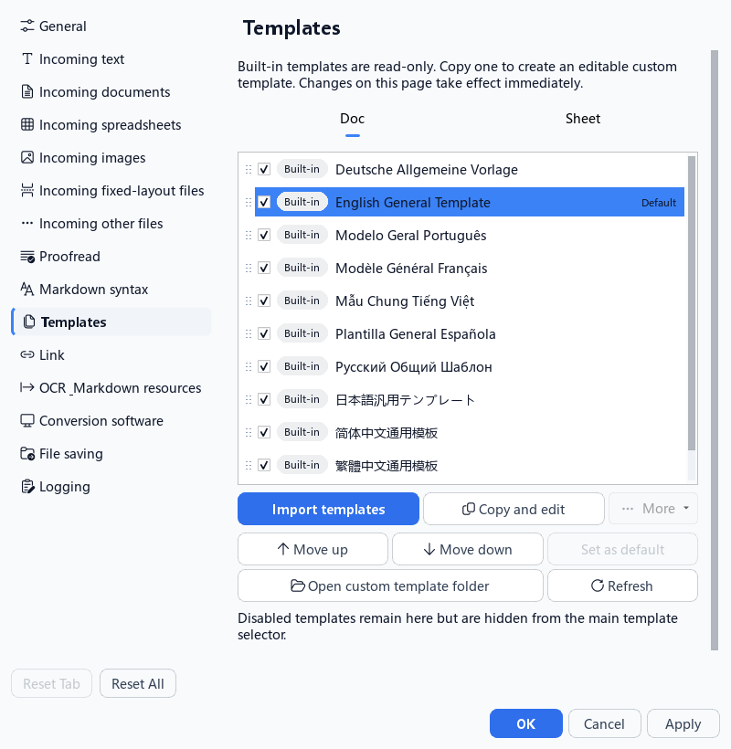

# DocWen

<p align="center">
  
</p>

[English](https://github.com/ZHYX91/docwen/blob/main/README.md) · [简体中文](https://github.com/ZHYX91/docwen/blob/main/docs/user-guides/README.zh-CN.md) · [繁體中文](https://github.com/ZHYX91/docwen/blob/main/docs/user-guides/README.zh-TW.md) · [Deutsch](https://github.com/ZHYX91/docwen/blob/main/docs/user-guides/README.de-DE.md) · [Français](https://github.com/ZHYX91/docwen/blob/main/docs/user-guides/README.fr-FR.md) · [Español](https://github.com/ZHYX91/docwen/blob/main/docs/user-guides/README.es-ES.md) · [Português](https://github.com/ZHYX91/docwen/blob/main/docs/user-guides/README.pt-BR.md) · [Русский](https://github.com/ZHYX91/docwen/blob/main/docs/user-guides/README.ru-RU.md) · [日本語](https://github.com/ZHYX91/docwen/blob/main/docs/user-guides/README.ja-JP.md) · [한국어](https://github.com/ZHYX91/docwen/blob/main/docs/user-guides/README.ko-KR.md) · [Tiếng Việt](https://github.com/ZHYX91/docwen/blob/main/docs/user-guides/README.vi-VN.md) · [العربية](https://github.com/ZHYX91/docwen/blob/main/docs/user-guides/README.ar.md)

DocWen 在本机转换办公文件。它能把 Word 转成 Markdown、把 Markdown 导出为 Word、从 PDF 中提取文字和表格，也能处理电子表格、图片和常见的文件整理任务。日常操作用图形界面；需要批量自动化时用命令行。

界面语言仅控制应用文案和布局；通用设置中的“任务输出语言”独立控制生成标签、文档样式及校对批注，不翻译正文。切换界面不会更改已保存的输出语言或模板。OCR“自动”跟随任务输出语言。Markdown 语法中的“每行独立成段”默认关闭，可为普通正文逐行生成 Word 段落。

## 适合做什么

- **Word 与 Markdown 互转**：处理标题、表格和公式；特殊的 Obsidian 语法需要按需开启对应扩展。
- **表格转换**：把 Excel 等表格导出为 Markdown，或从 Markdown 生成表格文件。
- **PDF 与版式文件**：从 PDF、XPS、OFD 提取文字或转换文件，也能合并、拆分 PDF。
- **图片与 OCR**：转换常见图片格式，离线识别图片中的文字和部分表格；识别结果需要人工复核。
- **模板与校对**：用自定义模板生成文档，按自己的词库检查错别字、标点与符号。
- **单文件或批量处理**：桌面界面适合日常操作，CLI 适合重复任务。

DocWen 支持 DOCX、XLSX、PDF 和一些旧版办公、图片格式，但**并非所有格式之间都能互转**。具体取决于操作、系统平台及安装的转换软件，参见[能力说明](../capabilities.md)。

## 离线处理

文件由本机处理，不需要上传到在线转换服务。DocWen 限制自身 Python 进程内依赖的网络访问；外部启动的 Office、WPS、LibreOffice 仍遵循它们自身及系统的网络策略。处理敏感文件时，也应检查这些外部软件的配置。

## 📸 界面截图

为 Markdown 文档选择模板和生成选项。


在设置中导入、启用、排序和复制模板。



更新日志：见 [CHANGELOG.md](../CHANGELOG.md)

## 🚀 快速开始

### 从源码安装

**前置条件**：Python 3.12

**安装包**：提供 Windows x64 和 Ubuntu 24.04 x64 版本。其他 Linux 发行版与 macOS 需要从源码运行，目前没有正式安装包。

**使用 uv 安装**

安装 [uv](https://docs.astral.sh/uv/getting-started/)，然后：

```bash
git clone https://github.com/ZHYX91/docwen.git
cd docwen
uv sync --frozen --all-extras
```

请使用 `uv 0.12.0` 和仓库中的锁文件安装依赖。测试与正式构建使用这一版本；维护依赖时可使用兼容的 `uv 0.12.x`。`pip install -e` 无法应用本仓库的依赖排除规则，因此不支持这种安装方式。

### 启动程序

从 [Releases 页面](https://github.com/ZHYX91/docwen/releases) 下载对应安装包。Windows 版双击 `DocWen.exe`；Ubuntu 24.04 x64 图形版解压后运行 `./DocWen`，无桌面环境时使用单独的 `DocWenCLI` 包。从源码安装后可运行：

```bash
docwen-gui  # 图形界面
docwen      # 命令行
```

### macOS 安装说明

**当前限制**：macOS 上的 `convert`、`validate`、`number`、`merge`、`split` 操作目前都不可用。下面只记录开发实验所需的可选依赖。

**LibreOffice 支持（可选）**

如需转换 `.doc`、`.xls` 等旧格式，请安装 LibreOffice：\
下载地址：<https://www.libreoffice.org/download/>

**HEIC 图片支持（可选）**

如需处理 HEIC/HEIF 格式图片：

```bash
brew install libheif
pip install pillow-heif
```

### Linux GUI 版本前置条件

以下适用于 Ubuntu 24.04 x64 图形版；其他 Linux 发行版或处理器尚未列入安装包支持范围。

- 已安装桌面环境（GNOME、KDE、XFCE 等均可）
- GUI 基于 PySide6（Qt6），不再依赖 Python Tk；如启动时报缺少系统库，请按报错提示安装对应的 Qt 运行时依赖（常见为 OpenGL/X11 相关库）
- 没有桌面环境时，使用命令行包中的 `DocWenCLI`。从源码安装时使用 `docwen`。

### 快速入门指南

1. **准备一个 Markdown 文件**：
   ```markdown
   ---
   标题: 测试文档
   ---

   ## 测试标题

   这是测试正文内容。
   ```
2. **拖拽转换**：
   - 启动程序
   - 将 .md 文件拖入窗口
   - 选择模板
   - 点击"生成 DOCX"
3. **获取结果**：
   - Word 文档会保存在输出位置的结果文件夹中；点击“打开输出”即可找到。输出位置可在“设置 → 文件保存”中更改。

**提示**：新手可以使用 `samples/` 目录中的示例文件快速体验软件功能。

## 🖥️ 图形界面使用

大部分用户通过图形界面使用本软件，以下是详细的操作指南。

### 界面概览

程序采用**自适应三栏布局**设计：

| 区域          | 说明             | 显示时机       |
| ----------- | -------------- | ---------- |
| **中栏（主区域）** | 文件拖拽区、操作面板、状态栏 | 始终显示       |
| **右栏**      | 模板选择器 / 格式转换面板 | 选择文件后自动展开  |
| **左栏**      | 批量文件列表（按类型分组）  | 切换到批量模式时显示 |

### 基本操作流程

1. **启动程序**：双击 `DocWen.exe`（Windows 打包版）或运行 `docwen-gui`
2. **导入文件**：
   - 方式一：直接拖拽文件到窗口
   - 方式二：点击拖拽区域的"添加"按钮选择文件
3. **选择模板**（如需转换）：右侧模板面板自动展开，选择合适的模板
4. **配置选项**：在操作面板中勾选需要的转换/导出选项
5. **执行操作**：点击对应的功能按钮（如“导出 Markdown”、"生成 DOCX"等）
6. **查看结果**：状态栏显示处理进度和结果，可点击右侧的“打开输出”操作打开输出位置

### 单文件模式与批量模式

程序支持两种处理模式，可通过文件拖拽区域的切换按钮切换：

**单文件模式**（默认）：

- 一次处理一个文件
- 界面简洁，适合日常使用

**批量模式**：

- 可同时导入多个文件
- 左栏显示分类文件列表（按文档/表格/图片等分组）
- 支持批量添加、移除、排序
- 点击列表中的文件可切换当前操作对象

### 操作面板功能

操作面板根据文件类型自动调整可用选项：

| 文件类型            | 可用操作                |
| --------------- | ------------------- |
| Word文档          | 导出MD、转换PDF、文本校对、OCR |
| Markdown        | 转换DOCX、转换PDF、文本校对   |
| Excel表格         | 导出MD、转换PDF、表格汇总     |
| PDF文件           | 导出MD、合并、拆分、OCR      |
| 图片文件            | 格式转换、压缩、OCR         |
| HTML/EPUB/PPTX等 | 导出MD                |

### 设置界面

点击窗口底部的设置图标或按 **Ctrl+,** 打开设置。

在 **通用 → 界面外观** 中选择小、标准、大三档字号，以及 **90%、100%、110%、125%、150%** 五档界面缩放。100% 跟随系统缩放；例如系统 200% 配合本软件 90%，名义比例为 180%。更改即时预览，“应用”或“确定”保存，“取消”恢复上次保存的外观。

设置还包括传入文件、校对、Markdown 语法与资源、模板、链接、转换软件、文件保存和日志。

### 快捷操作

- **拖拽外部文件**：直接拖入窗口即可导入
- **打开输出**：点击状态栏右侧的“打开输出”操作打开输出位置
- **右键模板项**：打开模板文件位置

***

## 🔧 命令行使用

使用命令行（CLI）可以在终端检查文件、执行转换，或编写脚本处理重复任务。与其他软件集成时，请使用下文的 Machine Protocol 接口。

### 推荐自动化调用顺序

编写本机自动化脚本时，可以按下面顺序检查并执行转换：

1. `inspect <file> [--json]`：先识别文件真实类别、格式与可执行动作。
2. `resources list formats --json`：查看可用的转换格式，以及所需软件是否已安装。
3. `schema convert`：查看 `convert` 接受的参数、默认值和使用条件。
4. `convert <file> --to <fmt> (--output-dir <dir> | --output <path>) --dry-run --json`：检查识别到的格式、转换方法和参数，不生成文件。
5. `convert <file> --to <fmt> (--output-dir <dir> | --output <path>) ...`：确认后再执行正式转换。

其他软件或插件通过 `serve --stdio` 使用 Machine Protocol v2：查询可用操作、规划任务，再执行。这是用于软件集成的稳定接口；CLI 的 `--json` 供终端脚本读取结果。需要打开桌面界面或将文件传给 DocWen 时，使用 `gui open|activate|status`。详见[命令行说明](../cli.md)和[集成协议](../specs/machine-protocol-v2.md)。

### 常用示例

传入或生成 Markdown 的转换统一在 `--output-dir DIR` 指定的父目录下创建结果文件夹，即使只有一个输出文件；名称包含原文件名、时间戳和本次传入格式。其他只生成单个文件的转换才使用 `--output PATH` 指定精确文件路径。

```bash
# Windows 打包版
DocWenCLI.exe inspect document.docx --json

# 查看 convert 接受的参数
DocWenCLI.exe schema convert

# 预演本次转换会如何执行，但不实际写出结果
DocWenCLI.exe convert report.docx --to md --output-dir exports --extract-img --ocr --dry-run --json

# 导出 Word 为 Markdown（提取图片 + OCR）
DocWenCLI.exe convert report.docx --to md --output-dir exports --extract-img --ocr

# Markdown 转 Word（指定模板，并设置标题+正文合并模式）
DocWenCLI.exe convert document.md --to docx --output-dir exports --template template.docx.4be17c7a0791c896a542605427f1c3cb6597892292f2f9ddc6df82047d2120bf --heading-merge-mode punct_required

# Markdown 转 Word，并在保存前校对生成的 DOCX
DocWenCLI.exe convert document.md --to docx --output-dir exports --proofread --check typo --check punct

# 选择图片保存方式和 OCR 文字位置
DocWenCLI.exe convert report.docx --to md --output-dir exports --extract-img --image-mode file --ocr --ocr-placement image_md

# 检查可用转换和所需软件
DocWenCLI.exe doctor --json
DocWenCLI.exe resources list formats --json

# 文档校对
DocWenCLI.exe validate document.docx --check typo --check punct
DocWenCLI.exe validate input.md --check typo --check punct

# 源码 / uv 安装
# inspect -> schema -> dry-run -> convert
# docwen inspect document.docx --json
# docwen schema convert
# docwen convert document.docx --to md --output-dir exports --dry-run --json
# docwen convert document.docx --to md --output-dir exports
```

### 常用命令与选项

下表只列出常用命令；完整命令请以 `docwen --help`（源码 / uv 安装）或 `DocWenCLI --help`（打包版）为准。

| 命令/选项 | 说明 |
| --- | --- |
| `convert <file> --to <fmt> (--output-dir <dir> \| --output <path>)` | 转换一个文件。涉及 Markdown 时使用 `--output-dir` 保存结果文件夹；其他单文件转换使用 `--output` 指定文件路径。 |
| `convert <markdown> --to docx --output-dir <dir> --proofread [--check ...]` | Markdown→DOCX 转换后校对；`--check` 必须与 `--proofread` 同时使用，省略 `--check` 时使用已配置的校对默认值。 |
| `convert <file> --to <fmt> (--output-dir <dir> \| --output <path>) --dry-run --json` | 检查文件格式、转换方法和参数，不生成文件。 |
| `validate` / `number markdown` / `merge` / `split` | 分别用于校对文字、添加或移除标题编号、合并文件和拆分 PDF。 |
| `validate <file> --check ... [--report <path>]` | 默认只读校对；只有显式指定 `--report` 才写出报告文件。 |
| `schema convert` | 列出转换参数、默认值和使用条件，便于脚本读取。 |
| `inspect <file> [--json]` | 查询文件类别/格式、推荐动作，以及扩展名与内容不一致警告。 |
| `doctor --json` | 检查安装情况、可用转换和所需软件。 |
| `resources list formats --json` | 列出可用转换格式、所需软件和当前限制。 |
| `resources list optimizations --json` | 列出可用优化类型及其适用的转换。 |
| `resources list templates` | 列出可用模板。 |
| `resources list numbering-schemes` | 列出可用序号方案。 |
| `gui open [ABSOLUTE_FILE] [--timeout <seconds>] [--json]` | 打开 DocWen 窗口，并可同时传入一个文件。文件路径必须是绝对路径。 |
| `--template <id>` | 请填写 `resources list templates` 返回的资源 ID，不能使用模板名或路径。DOCX ID 用于 `docx/doc/odt/rtf/wps/pdf`，XLSX ID 用于 `xlsx/xls/ods/csv`。 |
| `--extract-img` / `--no-extract-img` / `--ocr` | `convert --to md` 的图片提取与 OCR 选项。 |
| `--image-mode file\|base64\|embed\|omit` | 选择导出图片的保存或嵌入方式。 |
| `--ocr-placement image_md\|main_md` | 控制 OCR 文本写入图片配套 Markdown 还是主 Markdown。 |
| `--heading-merge-mode punct_required\|always\|never` | 控制 `convert --to docx` 时“标题 + 正文”段落合并策略。 |
| `--optimization <id>` | 显式启用某个优化配置（可用列表见 `resources list optimizations`）。 |
| `batch convert\|validate ... --jobs <n> [--continue-on-error]` | 批量处理控制。 |
| `--json` / `--quiet` / `--timing` | 在终端脚本中输出 JSON、减少日志，或显示耗时。 |


## 📝 Markdown 语法约定

**需要识别 Obsidian 扩展语法吗？** 新安装的 DocWen 默认**关闭**四类可选扩展：`structural_tables`（合并单元格、多行表头）、`captions_references`（Number Suite 题注和交叉引用）、`extended_headings`（七至九级标题）、`typed_endnotes`（带类型的尾注）。

- **Markdown → Word**：进入 **设置 → Markdown 语法 → 输入**，勾选笔记用到的扩展，或点击输入方向的**使用 Obsidian 扩展**。未启用时，部分特殊记号会保留为普通文字。
- **Word → Markdown**：还需要在**输出**方向分别开启对应扩展（或使用输出方向的预设）；否则部分结构会降级、规范化或给出警告。

请保留原始 Markdown 并检查生成的 DOCX。Word 编号由 DocWen 的转换选项决定，往返转换不保证原文标记与空白逐字一致。具体见 [Markdown 兼容规范](../specs/markdown-compatibility.md)。

### 标题级别映射

Markdown 标题与 Word 标题级别直接对应：

- 文档的标题（title）和副标题（subtitle）放在YAML元数据中
- Markdown的 `# 一级标题` 对应 Word的"标题1"
- Markdown的 `## 二级标题` 对应 Word的"标题2"
- 一级至六级使用标准 Markdown 语法。七级至九级需先在 Markdown 输入设置中启用“七至九级标题”，再使用七至九个开头的 `#`

**提示**：如果您习惯用 Markdown 的一级标题（`#`）表示文档标题（title），从二级标题（`##`）开始表示正文小标题（heading），可以在 Word 模板中将"标题1"样式调整为文档标题的外观（如居中、加粗、较大字号），并在设置的序号方案中选择"跳过一级标题编号"的方案。这样，一级标题就能呈现为文档标题的效果。

### 换行与分段

**基本规则**：每个非空行默认作为独立段落处理。

**混合段落**：当小标题需要与正文混合在同一段时（默认“有标点才合并”模式），需满足以下条件：

1. 小标题末尾是设置中允许的触发符号。默认值精确为 `。：！？.:!?`，即全角或半角的句号、冒号、问号、叹号
2. 正文文本位于小标题的**紧邻下一行**
3. 正文行不能是特殊 Markdown 元素（如标题、代码块、表格、列表、引用、公式块、分隔线等）

**示例**：

```markdown
## 一、工作要求。
本次会议要求各单位认真落实...
```

上述两行会被合并为同一段落，其中"一、工作要求。"保持小标题格式，"本次会议..."为正文格式。

**注意**：

- 小标题和正文之间不能有空行，否则会被识别为独立段落
- 默认情况下（有标点才合并模式），如果小标题末尾没有结束标点符号，即使与正文之间无空行，也会被识别为独立段落，不会合并
- 可在“设置 → 传入文本 → Markdown 转为文档 — 格式处理”中调整“标题 + 正文合并模式”和触发符号。触发符号留空时，“有标点才合并”模式不会合并任何段落
- 逗号、分号、顿号、破折号和省略号默认不触发合并；确有需要时可以由用户明确加入

### 分隔线双向转换

支持 Markdown 分隔线与 Word 分页符/分节符/分隔线的双向转换：

- **DOCX → MD**：Word 中的分页符、分节符、分隔线自动转换为 Markdown 分隔线
- **MD → DOCX**：Markdown 中的 `---`、`***`、`___` 自动转换为对应的 Word 元素
- **可配置**：具体映射关系可在设置界面自定义

### 任务列表

支持 GFM 任务列表的双向转换：

```markdown
- [ ] 待办事项
- [x] 已完成
```

- **MD → DOCX**：渲染为无序列表，文本前添加 `☐` / `☑` 前缀
- **DOCX → MD**：识别列表项中的 `☐` / `☑` / `☒` 前缀，还原为 `- [ ]` / `- [x]`
- **字体提示**：`☐`/`☑` 在部分字体下可能无法显示，如有需要请在 Word 模板中使用 "Segoe UI Symbol" 等支持该字符的字体

### 图片嵌入与尺寸

支持 Obsidian/Wiki 与标准 Markdown 图片嵌入，并可指定宽高（单位：px）：

```markdown
![[image.png]]
![[image.png|300]]
![[image.png\|300]]


```

- 未指定尺寸：使用图片原始尺寸，但不超过页面/单元格可用宽度
- 指定尺寸：允许放大，但仍受可用宽度上限限制
- 纯图片段落：自动使用“图片”段落样式（居中、单倍行距）

### 链接处理

支持 Markdown -> DOCX 的可点击链接：

```markdown
[Docwen](https://example.com)
[[Target]]
[[Target|Open target]]
<https://example.com>
<user@example.com>
```

- Markdown 链接和 Wiki 链接默认写入为 Word 超链接
- Wiki 链接在找到目标文件时会解析为本地 `file:///` 链接
- 尖括号自动链接支持 `https://...` 和邮箱 `mailto:...`
- 裸 URL 默认不转换成可点击链接；如需在 Word 中启用，可将 `configs/link.toml` 的 `[non_embed_links].auto_link_bare_url` 设为 `true`
- Markdown -> XLSX 不生成 DOCX 超链接占位符，会保留原始链接语法

## 📖 详细使用指南

### Word 转 Markdown

1. 将 .docx 文件拖入程序窗口
2. 选择导出选项，点击“导出 Markdown”
3. 生成包含 YAML 元数据的 .md 文件

**支持的格式**：

- `.docx` - 标准 Word 文档
- `.doc` - 自动生成 DOCX 后处理
- `.wps` - WPS 文档自动转换

**导出选项说明**：

| 选项           | 说明                                                                      |
| ------------ | ----------------------------------------------------------------------- |
| **提取图片**     | 勾选后，将文档中的图片提取到输出文件夹，MD文件中插入图片链接                                         |
| **图片文字识别** | 识别图片中的文字。根据图文输出位置设置，保存在每张图片配套的 Markdown 中，或写入主 Markdown 文件。 |
| **针对文档类型优化** | 选择适合文档类型的优化，例如从公文中提取字段；不启用时使用标准转换。 |
| **清除原有文档小标题序号**  | 勾选后，移除小标题前的序号（如"一、""（一）""1."等），转换为纯标题文本                                 |
| **新增小标题序号**  | 勾选后，根据标题层级自动添加序号（可在设置中配置序号方案）                                           |

Word/WPS 多级列表生成的标题序号在导出时会保留。勾选“清除原有文档小标题序号”可移除这些序号，标题级别仍会保留。

### Markdown 转 Word

1. 准备 .md 文件；如需填写标题或自定义字段，可在开头添加 YAML 信息
2. 拖入程序窗口并选择对应的 Word 模板
3. 将目标格式设为 DOCX，点击“生成 DOCX”，填充模板并保存文档

**转换选项说明**：

| 选项          | 说明                                      |
| ----------- | --------------------------------------- |
| **清除原有Markdown小标题序号** | 勾选后，移除小标题前的序号（如"一、""（一）""1."等），转换为纯标题文本 |
| **新增小标题序号** | 勾选后，根据标题层级自动添加序号（可在设置中配置序号方案）           |

**注意**：如果存在小标题和正文文本混合的段落，在MD文件中需要保持严格换行（参见上方"换行与分段"说明）。

### 模板样式自动处理

转换器在 Markdown → DOCX 转换时会自动检测和处理模板样式：

#### 样式分类

**段落样式（Paragraph Style）**：应用到整个段落

| 样式                | 检测行为   | 缺少时添加              | 来源      |
| ----------------- | ------ | ------------------ | ------- |
| 标题 (heading 1\~9) | 检测段落样式 | 模板标题样式             | Word 内置 |
| 代码块               | 检测段落样式 | Consolas 字体 + 灰色背景 | 本软件定义   |
| 引用 (Quote 1\~9)   | 检测段落样式 | 灰色背景 + 左边框         | 本软件定义   |
| 公式块               | 检测段落样式 | 公式专用样式             | 本软件定义   |
| 分隔线 (1\~3)        | 检测段落样式 | 底部边框段落样式           | 本软件定义   |

**字符样式（Character Style）**：应用到选中的文字

| 样式   | 检测行为   | 缺少时添加              | 来源    |
| ---- | ------ | ------------------ | ----- |
| 行内代码 | 检测字符样式 | Consolas 字体 + 灰色底纹 | 本软件定义 |
| 行内公式 | 检测字符样式 | 公式专用样式             | 本软件定义 |

**表格样式（Table Style）**：应用到整个表格

| 样式  | 检测行为   | 缺少时添加   | 来源    |
| --- | ------ | ------- | ----- |
| 三线表 | 用户配置优先 | 三线表样式定义 | 本软件定义 |
| 网格表 | 用户配置优先 | 网格表样式定义 | 本软件定义 |

**编号定义（Numbering Definition）**：用于列表格式

| 类型   | 检测行为              | 缺失时处理                |
| ---- | ----------------- | -------------------- |
| 列表编号 | 扫描模板中已有的有序/无序列表定义 | 使用 decimal/bullet 预设 |

#### 样式名国际化说明

- **Word 内置样式**（标题 heading 1\~9）：
  - 样式名使用 Word 标准英文名称（如 `heading 1`）
  - Word 根据系统语言自动本地化显示（中文系统显示为"标题 1"）
- **本软件定义的样式**（代码块、引用、公式、分隔线、表格等）：
  - 按界面语言为新增样式命名
  - 中文界面：使用"代码块"、"引用 1"、"三线表"等
  - 英文界面：使用 "Code Block"、"Quote 1"、"Three Line Table" 等

**使用建议**：在模板中自定义样式后，转换器会自动使用您的样式；如果模板中没有，会使用内置预设样式。

### 表格文件处理

1. **Excel/CSV 转 Markdown**：添加 `.xlsx` 或 `.csv` 文件，点击“导出 Markdown”。
2. **Markdown 转 Excel**：可将 Markdown 表格导出为 XLSX；XLSX 模板支持 YAML 字段、纵向/横向表格列占位符、图片占位符、合并/保护单元格处理和 Markdown 表格合并恢复。

**支持的格式**：

- `.xlsx` - 标准 Excel 文档
- `.xls` - 自动转换为 XLSX 后处理
- `.et` - WPS 表格自动转换
- `.csv` - CSV 文本表格
- `.tsv` - TSV 制表符分隔表格

### 文本校对功能

程序提供四种可自定义的校对规则：

1. **标点配对检查** - 检测括号、引号等成对标点是否匹配
2. **符号校对** - 检测中英文标点混用问题
3. **错别字检查** - 基于自定义词库检查常见错别字
4. **敏感词检测** - 基于自定义词库检测敏感词

**自定义词库**：在程序的"设置"界面中可视化编辑错别字库和敏感词库。

**使用方法**：

1. 将需要校对的 Word 或 Markdown 文档拖入程序
2. 勾选需要的校对规则
3. 点击“文档校对”按钮
4. Word 文档的校对结果以批注形式显示在文档中；Markdown 文件的校对结果输出为结构化 JSON 报告

命令行使用 `validate <file>` 检查文件，默认不修改原文件。加上 `--report <path>` 可保存校对结果：Markdown 生成 JSON 报告，Word 及支持的旧版文档格式生成带批注的 DOCX。`--json` 用于把命令的执行结果打印为 JSON。

## 🛠️ 模板系统

### 使用现有模板

在**设置 → 模板**中统一管理 DOCX/XLSX 模板，可启用、停用、排序和设置默认项。内置模板只读，自定义模板保存在用户可写目录；MSIX 用户无需修改 WindowsApps。

### 自定义模板

1. 选择内置模板并点击**复制并编辑**，或使用**导入模板**添加已有 DOCX/XLSX 文件。
2. 在 Word、Excel 或 WPS 中修改自定义副本的内容、样式和占位符，具体规则见下文。
3. 保存文件，返回 DocWen 点击**刷新**，无需重启。

### 占位符使用说明

#### Word 模板占位符

**YAML 字段占位符**：在模板中使用 `{{字段名}}` 格式，转换时会被 Markdown 文件 YAML 头部的对应值替换。

| 占位符 | 说明 |
| --- | --- |
| `{{标题}}` | 文档标题（获取规则见下方说明） |
| `{{正文}}` | Markdown 正文内容插入位置 |
| 其他 | 支持任意自定义字段 |

**标题获取优先级**：

| 优先级 | 来源                | 说明                |
| --- | ----------------- | ----------------- |
| 1   | YAML `标题` 字段      | 最高优先级             |
| 2   | YAML `aliases` 字段 | 取列表第一个元素，或字符串值    |
| 3   | 文件名               | 去除 `.md` 扩展名后的文件名 |

**多语言支持**：标题和正文占位符支持多语言写法，如标题可使用 `{{标题}}`、`{{title}}`、`{{Titel}}` 等，正文可使用 `{{正文}}`、`{{body}}`、`{{Inhalt}}` 等。

#### Excel 模板占位符

XLSX 模板支持 YAML 字段占位符、纵向 `{{↓字段}}`、横向 `{{→字段}}` 表格列占位符、图片占位符、合并/保护单元格处理和 Markdown 表格合并恢复。

**1. YAML 字段占位符** `{{字段名}}`

用于填充 Markdown 文件 YAML 头部的单一值：

```markdown
---
报表名称: 2024年度销售统计表
编制单位: 销售部
编制日期: 2024年12月31日
---
```

模板中的 `{{报表名称}}`、`{{编制单位}}` 等会被替换为对应值。标题字段同样按优先级获取（YAML标题 → aliases → 文件名）。

**2. 列填充占位符** `{{↓字段名}}`

从 Markdown 表格提取数据，从占位符位置开始**向下**逐行填充：

```markdown
| 产品名称 | 销售数量 |
|---------|---------|
| 产品A | 100 |
| 产品B | 200 |
```

Excel 模板中的 `{{↓产品名称}}` 会被替换为"产品A"，下一行填充"产品B"。

**3. 行填充占位符** `{{→字段名}}`

从 Markdown 表格提取数据，从占位符位置开始**向右**逐列填充：

```markdown
| 月份 |
|------|
| 1月 |
| 2月 |
| 3月 |
```

Excel 模板中的 `{{→月份}}` 会依次向右填充"1月"、"2月"、"3月"。

**合并单元格处理**：

- Markdown → Excel 会保留模板原有的合并单元格。
- 对由连续整格 `{{↓字段名}}` 组成的已知列式模板区域，支持根据 Markdown 表格中的显式 `<` / `^` 合并标记恢复矩形合并。
- 只有整个单元格的内容为 `<` 或 `^`（忽略首尾空白）时才会识别为合并标记；`\<`、`\^` 会保留为字面文本。
- 合并区域无法组成矩形，或与模板已有合并单元格冲突时，会保留为普通文本并提示警告，模板结构保持不变。

**多表格数据合并**：如果 Markdown 中有多个表格使用相同的表头名，数据会按顺序合并后依次填充。

## 🔌 Obsidian 插件

配套 Obsidian 插件已在独立仓库发布，可与转换器联动使用：

### 核心特性

- **🚀 一键启动** - 侧边栏图标快速启动转换器
- **📂 自动传递** - 自动传递当前打开的文件路径
- **🔄 复用已打开的窗口** - 转换器正在运行时，直接打开新文件，无需重新启动

### 使用方式

DocWen Assistant 3.3 支持 Windows 和 Linux 桌面端；Windows Microsoft Store 安装版可使用自动检测，Linux 使用手动选择的兼容解压包。Assistant 目前不支持 macOS。

1. **首次点击** → 启动转换器并打开当前文件
2. **再次点击（有打开的文件）** → 用该文件替换当前输入文件（单文件模式）
3. **再次点击（没有打开的文件）** → 将转换器窗口切到前台

### 安装方法

安装 [DocWen Assistant](https://github.com/ZHYX91/obsidian-docwen-assistant) 前，需要先安装兼容的 DocWen。Assistant 3.3 要求 DocWen 0.17.0 或更高版本；插件不会代为安装主程序。请按发布说明选择兼容版本。开发集成时，这些版本使用 Machine Protocol v2 通信，并以 Artifact Bundle v3 返回转换结果。

## 🔌 OpenClaw（插件 + Skill）

[docwen-openclaw](https://github.com/ZHYX91/docwen-openclaw) 让 OpenClaw 调用本机 DocWen 转换和校对文件。需要单独安装 DocWen，并按插件发布说明选择兼容版本。插件 3.0 使用 Machine Protocol v2 和 Artifact Bundle v3。请下载正式发布的安装文件；源码中的版本号不代表该版本已可下载。

## ❓ 常见问题

### 转换失败怎么办？

- 检查文件是否被其他程序占用
- 确认文件格式正确
- 打开“设置 → 日志”，找到实际日志文件并查看错误详情

### 模板不显示？

- 在**设置 → 模板**中确认模板已启用，且与当前输出格式一致。
- 确认 DOCX/XLSX 文件可以正常打开。
- 外部修改后点击**刷新**；新增文件使用**导入模板**。

### 校对功能不工作？

- 确认文档为 .docx 或 .md 格式
- 检查文档是否包含可编辑文本
- 在设置中确认校对规则已启用

### 输出格式不符合预期？

- 打开**设置 → 模板**：内置模板先**复制并编辑**，自定义模板可直接**编辑**。
- 在 Word、Excel 或 WPS 中调整样式，保存后刷新列表。
- 生成新文件前选择该自定义模板。

### Excel转Markdown后公式单元格为空？

DocWen 导出的是公式单元格**上次保存的计算结果**。如果文件里没有保存这个结果，导出的单元格就会为空；由其他程序生成的文件，或修改后没有重新计算并保存的文件，都可能出现这种情况。

**解决方法**：

1. 在 Excel 中打开文件
2. 等待公式计算完成
3. 保存文件
4. 重新转换

## 🔒 安全特性

DocWen 在本机处理文件，不提供文件上传、遥测、在线下载或网络服务功能。程序会限制自身 Python 组件的网络访问；如果这项防护无法启用，DocWen 不会继续运行。

单独启动的 Word/Office、WPS、LibreOffice 等程序及相关辅助进程，仍遵循各自和系统的网络设置，不受这项限制。处理敏感文件时，也请检查这些程序的设置。

防护的实现和限制见[网络防护说明](../architecture.md)。如果程序无法启动或转换失败，可查阅[故障排查](../maintenance/troubleshooting.md)。

## 📜 许可证

本项目采用 **GNU Affero General Public License v3.0 (AGPL-3.0)** 许可证。

[](https://www.gnu.org/licenses/agpl-3.0)

- 本项目使用了 PyMuPDF（采用AGPL-3.0许可证），因此整个项目也采用AGPL-3.0许可证
- 当前 GUI 在支持的宿主路径中可使用 `PySide6-Fluent-Widgets`（QFluentWidgets）；其采用 `GPLv3 / 商业授权` 双轨模式，当前仓库继续按 AGPL 开源分发
- 您可以自由地使用、修改和分发本软件
- 如果您修改本软件并通过网络提供服务，必须向用户提供修改后的源代码
- 详细许可证信息请参阅 [LICENSE](../../LICENSE) 文件
- 第三方组件许可证登记请参阅 [LICENSE\_THIRD\_PARTY.txt](../../LICENSE_THIRD_PARTY.txt)；分发摘要见 [NOTICE.txt](../../NOTICE.txt)

### 联系方式

- **GitHub**: <https://github.com/ZHYX91/docwen>
- **联系作者**: <zhengyx91@hotmail.com>

***

**作者**：ZhengYX
